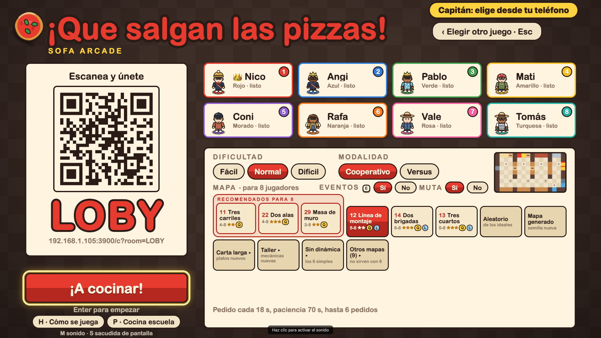
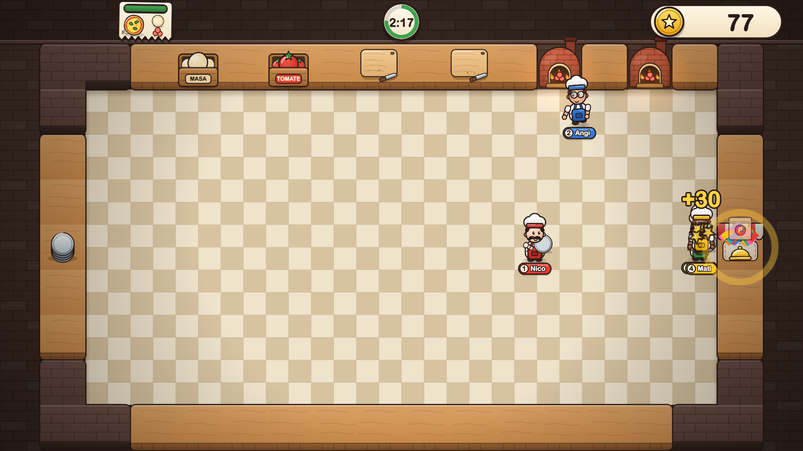
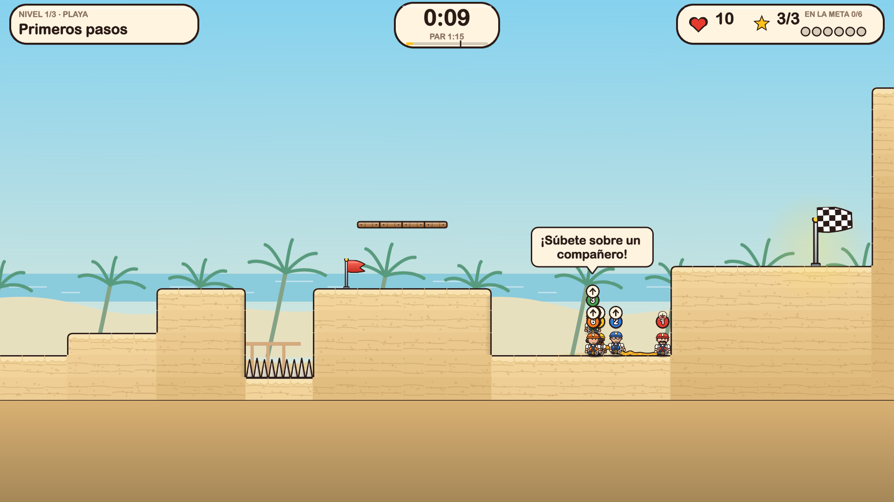
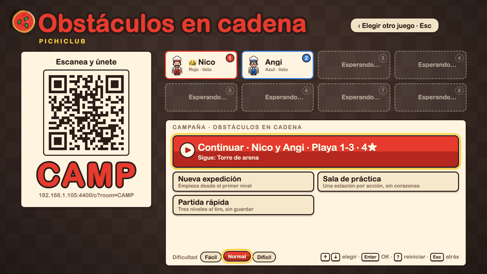
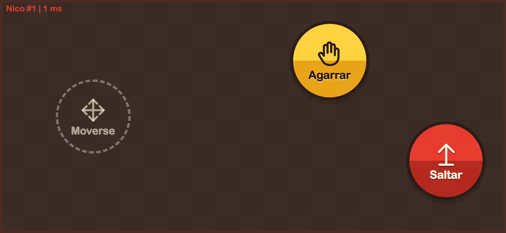

# Pichiclub

Party game local para jugar en el sofá: la **pantalla grande** (un Mac o una TV con navegador) corre el juego y los **celulares** son los controles. Nadie instala nada: el celular abre una URL (o escanea un QR) y listo. De 2 a 8 jugadores.



## Capturas

| Pizzas: entrega en el mostrador | Obstáculos: cruzando la playa |
|---|---|
|  |  |

| Menú de campaña de Obstáculos | Control en el celular (Obstáculos) |
|---|---|
|  |  |

## Juegos

Datos tomados de `games/*/manifest.ts` y `apps/catalog/src/games.ts`.

| Juego | Descripción | Jugadores | Modos |
|---|---|---|---|
| ¡Que salgan las pizzas! (`pizzas`) | Estira la masa, corta, hornea y entrega antes de que se acabe la paciencia. | 2-8 | Cooperativo; Duelo de cocinas (dos equipos, con opción de sabotaje y ventaja para el equipo chico) |
| Obstáculos en cadena (`obstaculos`) | Una cuadrilla de exploradores cruza cinco paisajes: salten, suban sobre sus compañeros y lleguen TODOS a la meta. | 2-8 | Cooperativo. El manifest no declara modos; la campaña ofrece Continuar, Nueva expedición, Sala de práctica y Partida rápida |
| Arena de empujones (`arena`) | Empuja a tus rivales fuera de la plataforma. | por definir | Próximamente: tarjeta no seleccionable en el menú |

Los controles son los mismos en el celular: un stick para moverte y dos botones (en Pizzas "Tomar / Soltar" y "Picar / Correr"; en Obstáculos "Saltar" y "Agarrar").

## Cómo correrlo

**Requisitos:** Node 20 o superior (`engines.node: ">=20"` en `package.json`; no hay `.nvmrc`) y npm. La pantalla y los celulares deben estar en la misma red local.

```bash
npm ci
npm run dev
```

- `npm run dev` levanta un solo server (relay WebSocket en `/ws`) con Vite incrustado para las dos apps. Puerto por defecto **3000**; cámbialo con `PORT=3200 npm run dev`.
- Al arrancar imprime dos URLs y un QR en la terminal:
  - Pantalla (se abre en el Mac/TV): `http://localhost:3000/screen` (`/` redirige ahí).
  - Celulares: `http://<IP-de-la-LAN>:3000/c`. La IP la detecta `platform/server/src/lan.ts` (primera IPv4 privada no interna).
- El lobby de la pantalla también muestra el QR y un código de sala de 4 letras (URL `/c?room=XXXX`): los celulares escanean y entran.
- `npm run build` + `npm start` sirven las apps ya compiladas (`dist/`) en el mismo puerto.
- Los puertos 3000 y 3100 suelen estar ocupados por quien desarrolla; para pruebas con Chrome usa `PG_PORT` y `PG_CDP_PORT` (por defecto 3600/9366).

### Tests y chequeos

| Qué | Comando |
|---|---|
| Tests rápidos | `npm run test:fast` |
| Tests lentos (goldens, regresión, validadores) | `npm run test:slow` |
| Un solo paquete | `npm run test:agent -- --project game-pizzas` |
| Puerta de equivalencia (suite completa, ~4 min; solo al integrar) | `npm run baseline:check` |
| Lint | `npm run lint` |
| Reglas de dependencias (avisos) | `npm run deps` |
| Tipos | `npm run typecheck` |

## Estructura

```
platform/  genérica: core (protocolo, contrato, registro), screen, controller, server
games/     un paquete por juego: pizzas, obstaculos (sim, screen, controller, tests)
apps/      raíces que ensamblan todo: screen (Phaser + DOM), controller (celular), server (express + ws)
tools/     capturas, e2e con Chrome, latencia y chequeos del repo (baseline, topes de tamaño)
```

- El sim de cada juego es código puro y determinista (sin DOM, Node ni Phaser).
- Cada juego tiene su `README.md` con módulos, invariantes y red de tests: `games/pizzas/README.md`, `games/obstaculos/README.md`.
- Mapa completo y objetivo de la reestructura: [ARCHITECTURE.md](ARCHITECTURE.md) (provisional, se reemplaza al cerrar la reestructura).

## Cómo contribuir

Reglas duras (detalle en [CLAUDE.md](CLAUDE.md)):

- **No toques goldens ni capturas.** `games/pizzas/test/golden/fixtures/*.json`, los hashes de regresión, `docs/screens/**` y `docs/refactor/baseline/` solo cambian con permiso explícito del dueño. Si un test rojo pide regrabarlos, detente y avisa.
- **No borres, saltes ni renombres tests** para ponerlos en verde. Un proyecto de Vitest con 0 tests cuenta como rojo.
- **Tamaño de archivos:** `.ts` 300 líneas aviso y 500 falla; tests 500/800; `.css` y `.html` 150/250; `index.ts` máximo 40 líneas y solo re-exports; carpeta 12/20 archivos. Límites en `size-budget.json`. Nada de `utils.ts`, `helpers.ts` ni `misc`.
- **La plataforma no importa juegos** (ni apps); los juegos no se importan entre sí. Solo las apps ensamblan juegos y plataforma. Se revisa con `npm run deps`.
- **`git add` con rutas explícitas de archivo**, nunca de directorio.
- **Ramas y PR:** una rama por cambio (idealmente en su propio `git worktree`) y PR contra `master`.
- Código en inglés, nombres de archivo en kebab-case. Antes de dar algo por listo: `npm run typecheck`, `npm run lint` y los tests del paquete que tocaste.

Si programas con Claude Code, usa la skill del repo `/sofa-arcade-dev` (en `.claude/skills/`, se agrega al cerrar la reestructura en curso).
